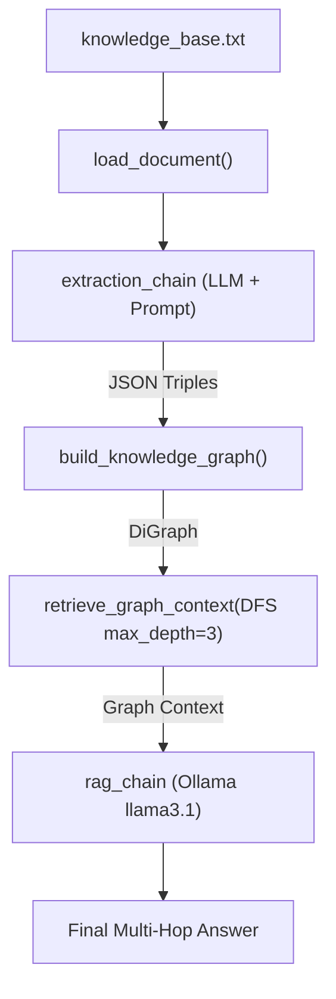

# GraphRAG (Intermediate Local Knowledge Graph RAG)

A lightweight, local implementation of **Graph Retrieval-Augmented Generation (GraphRAG)** built with **LangChain**, **NetworkX**, and **Ollama** (`llama3.1`).

---

## 💡 Overview

Standard vector-search RAG often struggles with multi-hop reasoning questions (such as *"Which company invested in the company that built ChatGPT?"*) because vector embeddings retrieve isolated text chunks based on semantic similarity rather than relational graph connections.

This project solves multi-hop reasoning by:
1. Converting raw documents into structured **knowledge graph triples** `(Head) -> [Relation] -> (Tail)`.
2. Constructing a directed graph (`DiGraph`) of entities and relationships using **NetworkX**.
3. Performing **Multi-Hop Traversal** (DFS exploring both incoming `predecessors` and outgoing `successors` edges) to assemble multi-link context.
4. Feeding the extracted graph context into **Ollama** (`llama3.1:latest`) for accurate, verifiable question answering.

---

## 🏗️ Architecture & Pipeline Flow



### Component Breakdown

* **[`load_document(source)`](file:///c:/Users/samga/Downloads/Quick%20Share/Projects%282025-26%29/Ollama_Based/RAG/GraphRAG%28Inter%29/main.py#L35-L49)**: Loads text content from `.txt`, `.md`, or `.pdf` files (by default [`knowledge_base.txt`](file:///c:/Users/samga/Downloads/Quick%20Share/Projects%282025-26%29/Ollama_Based/RAG/GraphRAG%28Inter%29/knowledge_base.txt)).
* **[`extraction_chain`](file:///c:/Users/samga/Downloads/Quick%20Share/Projects%282025-26%29/Ollama_Based/RAG/GraphRAG%28Inter%29/main.py#L32)**: Prompts Ollama (`llama3.1`, `temperature=0`) to extract facts into structured JSON triples `{"head", "relation", "tail"}`.
* **[`build_knowledge_graph(triples)`](file:///c:/Users/samga/Downloads/Quick%20Share/Projects%282025-26%29/Ollama_Based/RAG/GraphRAG%28Inter%29/main.py#L61-L76)**: Builds the NetworkX directed graph (`nx.DiGraph()`), creating nodes for entities and labeled edges for relations.
* **[`retrieve_graph_context(entity, max_depth)`](file:///c:/Users/samga/Downloads/Quick%20Share/Projects%282025-26%29/Ollama_Based/RAG/GraphRAG%28Inter%29/main.py#L83-L109)**: Runs Depth-First Search up to a configurable depth (e.g. `max_depth=3`) around a target entity (`ChatGPT`) to retrieve connected relational statements.
* **[`rag_chain`](file:///c:/Users/samga/Downloads/Quick%20Share/Projects%282025-26%29/Ollama_Based/RAG/GraphRAG%28Inter%29/main.py#L131)**: Formats the graph context and prompt into Ollama to return the multi-hop answer.

---

## ⚡ Quick Start

### 1. Prerequisites
* Python $\ge 3.12$
* [uv](https://github.com/astral-sh/uv) (recommended package manager)
* [Ollama](https://ollama.ai/) installed and running locally:
  ```bash
  ollama pull llama3.1:latest
  ```

### 2. Installation
```bash
# Install dependencies
uv sync
```

### 3. Execution
```bash
uv run python main.py
```

---

## 🌐 Graphify Codebase Knowledge Graph

This repository includes a full **Graphify** knowledge graph representing codebase architecture, file dependencies, and structural relationships.

Graphify outputs are generated in [`graphify-out/`](file:///c:/Users/samga/Downloads/Quick%20Share/Projects%282025-26%29/Ollama_Based/RAG/GraphRAG%28Inter%29/graphify-out):
* **[`graph.html`](file:///c:/Users/samga/Downloads/Quick%20Share/Projects%282025-26%29/Ollama_Based/RAG/GraphRAG%28Inter%29/graphify-out/graph.html)**: Interactive Vis.js HTML graph visualization. Open in your browser to inspect nodes, connections, and communities.
* **[`GRAPH_REPORT.md`](file:///c:/Users/samga/Downloads/Quick%20Share/Projects%282025-26%29/Ollama_Based/RAG/GraphRAG%28Inter%29/graphify-out/GRAPH_REPORT.md)**: Architectural analysis report listing God Nodes, communities, and suggested queries.
* **[`graph.json`](file:///c:/Users/samga/Downloads/Quick%20Share/Projects%282025-26%29/Ollama_Based/RAG/GraphRAG%28Inter%29/graphify-out/graph.json)**: Raw JSON graph payload.
